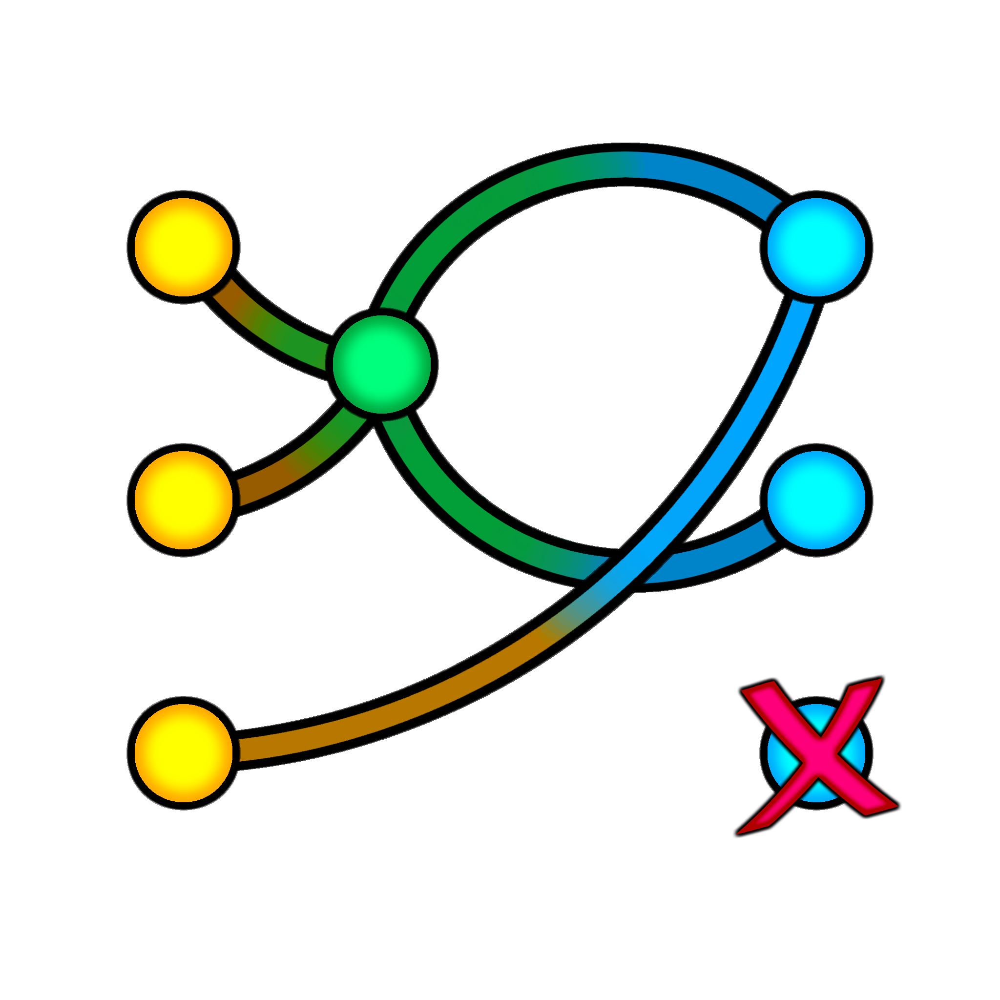

# Conduit



A PipeWire virtual mic/speaker router for NixOS, with a node-graph editor. Two
virtual devices — **Conduit Virtual Speaker** and **Conduit Virtual
Mic** — get created system-wide and set as your defaults. You then
patch real apps and real hardware in and out of them -- on a
qpwgraph-style canvas or in the classic lists -- and the routing
survives reboots.

## What it does

- Creates `Conduit Virtual Speaker` and `Conduit Virtual Mic`, sets
  them as your default output/input.
- Lets you route specific apps into the virtual speaker (for further
  mixing/processing) and specific real mics into the virtual mic.
- Lets you **bypass** an app around the virtual speaker entirely —
  e.g. Spotify goes straight to your real speakers instead of through
  the mix.
- Per-port links (just the left channel, a mono mic fanned to both),
  per-link and per-device volume, blocks that silence a device or keep
  a pair from ever being linked, and events ("when OBS starts
  recording, block Spotify").
- Everything is saved to `~/.config/conduit/state.json` and re-applied
  continuously by a background service, so replugging headphones or
  reopening an app doesn't lose the routing, and nothing needs to be
  redone after a reboot.

## Requirements

Your existing NixOS config needs PipeWire (with the PulseAudio
compatibility layer) already enabled:

```nix
services.pulseaudio.enable = false;
security.rtkit.enable = true;
services.pipewire = {
  enable = true;
  alsa.enable = true;
  pulse.enable = true;
};
```

(This is already the case in your `configuration.nix`.)

## Install

In your system flake:

```nix
inputs = {
  # ...
  conduit = {
    url = "github:mr-tinkle-winkle/conduit";
    inputs.nixpkgs.follows = "nixpkgs";
  };
};

outputs = inputs@{ self, nixpkgs, ... }: {
  nixosConfigurations.mrtw = nixpkgs.lib.nixosSystem {
    # ...
    modules = [
      ./configuration.nix
      inputs.conduit.nixosModules.default
      {
        services.conduit = {
          enable = true;
          user = "mrtw";
        };
      }
    ];
  };
};
```

Then:

```fish
sudo nixos-rebuild switch --flake .
```

Log out and back in (the daemon is a per-user systemd service that
starts with your session), then either run `conduit` from a terminal
or find **Conduit** in your app launcher.

## The window

At the very top, **Graphical | List** switches between the two editors.
Both edit the same config; switch whenever you like.

The toolbar keeps **Refresh devices**, **Auto Refresh Devices** (on by
default -- it's what keeps the canvas's link colours live), **Show
Unmanaged Links** (canvas only), **Auto-apply** and **Close to Tray**.

**Auto-apply** (on by default) does what Conduit always did: every edit
writes `state.json` and restarts the daemon (debounced ~600 ms). Turn it
off and edits stay pending -- the top bar shows "● Unsaved changes" and a
**Save** / **Discard** pair. Closing the window with pending edits asks
whether to save them.

### Graphical editor

One canvas split into boxes: **Speaker** top-left, **Microphone**
top-right, and each **Custom Conduit** in a row along the bottom. Drag
the dividers to resize them. Each box has its own zoom (mouse wheel) and
a **⛶** button that fills the window with that box (the same button or
**Esc** restores).

**Cells** are devices or app streams (matched by name, exactly like the
old list entries). Each box has fixed **hub** cells: the Virtual
Speaker, the Virtual Mic, and each Custom Conduit's sink (plus its mic
when "As Microphone" is ticked). Ports are drawn like qpwgraph: **L** and
**R** for stereo, one port for mono -- with a **Both** port behind L and
R. Drag from Both and you get the left *and* right link in one go.

| Do this | To |
|---|---|
| drag from a port to a port | link them (any output to any input, any box -- cell-to-cell links that skip the hubs are fine) |
| drag a cell | move it; drop it on another box to move it there |
| right-click empty canvas | **New Cell** (anything PipeWire has now, plus closed devices Conduit remembers), or in Speaker, **New Speaker** |
| right-click a cell | Auto-Detect, Add Event, Volume, Recolor, Block, Real Speaker, Move to, Delete |
| right-click a hub | enable / disable the box (a disabled box is dimmed and routes nothing), master volume, mute, noise suppression |
| right-click a link | Volume, Recolor, Block, Delete (applies to all selected links) |
| click / Shift-click a link, or drag a rectangle on empty canvas | select links; **Delete** removes them |
| middle-click a cell or link | block / unblock it (middle-click never pans) |
| Ctrl+drag empty canvas | pan (or use the scroll bars) |
| double-click empty canvas | fit the box |

**Link colours.** Gray: configured in Conduit but not linked in PipeWire
(yet -- e.g. the device is closed). Once live: **blue** into a virtual
device, **orange** out of a virtual device, **green** for an app linked
straight to a real speaker (bypass), **yellow** for any other
cell-to-cell link. **Very dark red**: blocked. Any link can be
recoloured; a recoloured link still goes gray while it isn't live. A
link volume shows as a gap in the line with the value in it; a cell's
volume shows above the cell.

**Cell states.** Blocked (very dark red) wins over everything: every
PipeWire link of that device is removed -- including WirePlumber's own --
so it's silent. Closed (the device doesn't exist right now): dimmed,
purple. Inactive (exists, no audio flowing): dimmed. A small "also in
…" line means the same device has another cell in another box.

**Speakers and bypass.** *New Speaker* adds a real output device and
links the Virtual Speaker to it; add as many as you like (speakers,
headphones, earbuds) and middle-click whichever you want silenced.
Linking an app straight to a speaker cell also creates a dark-red
**anti-link** from that app to the Virtual Speaker, which keeps
WirePlumber from also sending it into the mix. Delete the anti-link if
you want both. (This replaces the old Bypass list and Destination
picker.)

**Volumes** on cells and links are inline gain stages (a small
dedicated volume node per link), never the device's own volume. A link's
effective volume is cell × link × cell. The hub's master Vol / Mute in
the box header still uses `wpctl` on the virtual device itself.

**Events** (right-click a cell → Add Event): *becomes Active* (audio
flowing, debounced), *is Created*, *becomes Inactive*, *is Deleted*.
**Select Outcome** greys out the box -- middle-click a cell once to
block it, twice to unblock it (three times clears) -- then **Done**.
The daemon runs events even with the window closed, and the blocks they
set are saved (they survive reboots). Events don't fire for devices that
already existed when the daemon started.

**Show Unmanaged Links** also draws, dashed, the links Conduit didn't
make (WirePlumber's, an app's own) that touch anything on the canvas,
with dashed "ghost" cells for devices that aren't cells yet.
Right-click a dashed link → **Add to Conduit** or **Block**; right-click
a ghost cell → **Add as Cell**.

Cell positions, zoom, divider sizes and the remembered devices live in
`~/.config/conduit/layout.json`. The daemon never reads it, and moving
things never restarts anything.

### List editor

The old Speaker / Microphone / Custom Conduit panels. Each shows only
what's linked to that box's hub: **Input** (into the hub) and **Output**
(out of it). A row stands for every link between that thing and the
hub: its checkbox blocks / unblocks them, its spinbox sets their volume,
**^** is the cell's Auto-Detect, and **✕** removes just those links (and
the cell, if nothing else uses it). Anything the lists can't show --
per-port choices, cell-to-cell and bypass links, anti-links, events,
colours, positions, blocked cells -- is left exactly as it is.

### Auto-Detect

Per cell, unchanged from before -- for things like Discord/Vesktop that
spin up a differently-named stream per screen share:

- *Prefix match* -- "Chromium input-2" counts as a saved "Chromium input".
- *Keyword match* -- anything whose name contains the text, e.g. "vencord".
- *Same source app* -- every stream the same running app creates (only
  while the cell's own device is live).
- *Anti-Auto-Detect* -- comma-separated keywords that keep matches out
  of the sweep (never the cell's own device).

Matches are a routing-time decision only; they never get written back.

## Custom Conduits

**+ Custom Conduit** (above the bottom row) adds your own virtual patch
point. The box header has its **name** (click to rename), **As Speaker**
/ **As Microphone**, noise suppression (with As Microphone), **Vol** /
**Mute**, and **✕** to remove it (asks first). "As Microphone" adds a
second device that taps the conduit's mix as a recording device -- the
classic "Stereo Mix" pattern. Route anything into the conduit's hub and
out of it to anything else, including another conduit or the Virtual
Speaker.

Custom Conduits are created live by the daemon (no rebuild): renaming is
a quick destroy-and-recreate, and if the daemon isn't running the
conduit's device doesn't exist either.

## Master Volume and Mute

Every box header has a **Vol** field and a **Mute** checkbox — the
virtual device's own overall volume, distinct from cell and link
volumes (inline gain stages, 0–10x). This one is a plain text field with no upper limit — type whatever
multiplier you want. Volume of exactly `1.0` is left alone entirely
(same "not managing this" convention as everywhere else); mute is
always actively held either way, continuously re-applied every
reconcile cycle just like everything else in this app that's meant to
stay pinned rather than drift.

Every Custom Conduit has the same Vol/Mute pair for its own base
device (see above).

### Command-line flags

The same volume and mute controls are scriptable without opening the
GUI at all — useful for binding to a hotkey:

```fish
conduit --micVolume=0.5          # set the Microphone panel's overall volume
conduit --speakerVolume=2.0      # set the Speaker panel's overall volume
conduit --mute=mic               # mute the microphone
conduit --unmute=speaker         # unmute the speaker
conduit --togglemute="Game Mix"  # toggle mute on a Custom Conduit by name
```

`--mute` / `--unmute` / `--togglemute` take a target: `speaker`, `mic`,
or a Custom Conduit's name (quote it if it has spaces). Running any of
these applies the change and exits immediately without opening a
window — the GUI only opens when `conduit` is run with no flags at
all. Getting the target wrong (or leaving it off) prints the list of
currently valid targets and exits with an error rather than guessing.

## Noise Suppression

Needs a one-time opt-in in your NixOS config before it's usable at
all:

```nix
services.conduit.noiseSuppression.enable = true;
```

Rebuild, and the "Noise Suppression" button on the Microphone box
(and on any Custom Conduit box with "As Microphone" ticked) becomes
functional. On the canvas, picking a method splits the hub in two: the
Virtual Mic on top, the processor below it, with a dashed connector
between them. The processor's ports are linkable like any other cell. Unlike the two main virtual devices, nothing is
statically declared beyond that one option — picking a method spawns
a small dedicated PipeWire helper process for exactly that one thing,
and switching back to None (or removing whatever was using it) kills
it again. Nothing extra sits in your graph the rest of the time.
Expect a brief (~1-2 second) delay the first time you pick a method
for something, since it's starting a fresh process rather than
grabbing a pre-warmed one.

- **RNNoise** — a dedicated neural-network denoiser (needs nixpkgs'
  `rnnoise-plugin` package, pulled in automatically once the option
  above is enabled). The better-quality option.
- **WebRTC** — PipeWire's built-in noise suppression, no extra package
  needed, but per real-world reports noticeably weaker than RNNoise.
  Included as a no-extra-dependency fallback. Each instance still
  costs 4 nodes rather than RNNoise's 2 (the underlying echo-cancel
  module requires an echo-reference sink/playback pair even though
  nothing feeds it in this standalone use, which is what shows up as
  "Echo Cancel" entries in qpwgraph) — but only while something is
  actually using it, not permanently.

Every consumer (the Virtual Mic, each Custom Conduit) gets its own
fully independent instance, even if two things pick the same method
at once — never shared, since sharing would mean their audio gets
mixed together *inside* the processor before either is denoised.

For the Microphone box specifically, turning this on moves every link
that read from the Virtual Mic over to the processor (and back when you
turn it off), and the processor's output becomes the default input
device -- so it doesn't matter which way an app reaches the mic.

## Troubleshooting

Check the daemon's logs:

```fish
journalctl --user -u conduit-daemon -f
```

Each time the daemon (re)starts it logs a one-time inventory of every
node PipeWire currently knows about, including port counts -- if a
device isn't showing up in Conduit's dropdowns, grep for it there:

```fish
journalctl --user -u conduit-daemon -n 300 --no-pager | grep -i vencord
```

`in_ports=0 out_ports=0` on a device means it genuinely has no usable
ports at that moment (e.g. queried before or after the app that owns
it finished setting it up) -- restart the daemon while the device is
actually active and check again.

If a Noise Suppression selection doesn't seem to be doing anything,
the daemon logs every spawn/stop of its helper processes:

```fish
journalctl --user -u conduit-daemon -n 100 --no-pager | grep -i "noise suppression\|ns_"
```

You should see a "started <method> noise suppression for ..." line
with a pid, and its stderr (if the spawned `pipewire` process itself
hit an error -- bad plugin path, missing library) shows up in this
same log, since it inherits the daemon's own stdout/stderr rather than
being silenced. No such line at all means `sync_noise_processors`
never tried -- check that `services.conduit.noiseSuppression.enable`
is actually set and rebuilt, and for RNNoise specifically that
`CONDUIT_RNNOISE_LADSPA_PATH` reached the daemon's environment
(`systemctl --user show conduit-daemon -p Environment`).

If `nixos-rebuild` fails on a fresh clone with an error about
`environment.etc."pipewire<...>"` no longer being supported, you're on
an older copy of this repo from before that got fixed -- `git pull`
and rebuild again.

Check the virtual devices exist:

```fish
wpctl status
```

You should see `Conduit Virtual Speaker` and `Conduit Virtual Mic`
listed under Sinks/Sources. If they're missing, `nixos-rebuild switch`
didn't apply, or PipeWire needs a restart to pick up the new
`/etc/pipewire/pipewire.conf.d/` file:

```fish
systemctl --user restart pipewire pipewire-pulse wireplumber
```

Inspect the current graph directly:

```fish
pw-dump | less
```

Restart the daemon manually if needed (the GUI already does this on
every save):

```fish
systemctl --user restart conduit-daemon
```

## Config format

`~/.config/conduit/state.json`, schema version 2 (the full description
is at the top of `conduit_core.py`):

```json
{
  "version": 2,
  "speaker": {"enabled": true, "volume": 1.0, "muted": false},
  "mic": {"enabled": true, "volume": 1.0, "muted": false, "noise_suppression": "rnnoise"},
  "custom": {"next_id": 2, "conduits": [
    {"id": 1, "name": "Game Audio Mix", "enabled": true, "as_speaker": true,
     "as_microphone": true, "mic_noise_suppression": "webrtc", "volume": 1.0, "muted": false}
  ]},
  "cells": [
    {"id": "c1", "label": "spotify", "box": "speaker", "speaker": false, "volume": 1.0,
     "blocked": false, "color": null, "auto_detect": {"prefix": false, "keyword": false,
     "keyword_text": "", "same_app": false, "anti": false, "anti_keyword_text": ""},
     "events": [{"kind": "active", "outcomes": {"c2": "block"}}]},
    {"id": "c2", "label": "Analog Stereo Speakers", "box": "speaker", "speaker": true, "...": "..."}
  ],
  "links": [
    {"id": "l1", "src": "c1", "src_port": "FL", "dst": "c2", "dst_port": "FL",
     "volume": 1.5, "blocked": false, "color": null, "anti": false},
    {"id": "l3", "src": "c1", "src_port": "*", "dst": "hub:speaker", "dst_port": "*",
     "volume": 1.0, "blocked": true, "color": null, "anti": true}
  ],
  "next_cell_id": 3, "next_link_id": 4
}
```

- Hubs aren't cells; links name them as `hub:speaker`, `hub:mic`,
  `hub:custom.<id>`, `hub:custom.<id>.mic`, and the processors
  `ns:mic` / `ns:custom.<id>`.
- Ports are PipeWire channel names (`FL`, `FR`, `MONO`, ...). `*` means
  every port; it's what anti-links use.
- A blocked link is an anti-link: that pair is never linked, whoever
  makes it. A blocked cell is silent.

**Migration.** The first time the new daemon or GUI sees an old config,
it copies it to `state.v1.backup.json` and converts it: every list entry
becomes a cell with explicit L→L / R→R links (Mono entries: every port
to every port -- the Mono checkbox is gone, per-port links cover it);
`enabled: false` entries become blocked links; Bypass entries become
direct links to the Destination, which becomes a speaker cell, plus the
default anti-link; entry volumes move to their links. To go back, stop
the daemon and copy the backup over `state.json`.

`.link_cache.json` (what the daemon managed last cycle, so removing a
link undoes it once even across the restart) is unchanged and still safe
to delete.

## Repo layout

```
flake.nix              nixosModules.default + the conduit package / app
module.nix             services.conduit options, virtual devices, the daemon's user service
package.nix            the package (scripts, vendored qt_ui_kit, icons, wrapper)
conduit_core.py        state schema + migration, PipeWire parsing, the link plan (shared)
conduit_daemon.py      the router: polls PipeWire every 2 s and reconciles; runs events
conduit_gui.py         window, Graphical | List switch, toolbar, tray, CLI flags
conduit_controller.py  the GUI's model: edits, auto-apply / save, live refresh
conduit_graph.py       the node canvas
conduit_list.py        the list editor
conduit_header.py      a box's header (shared by both editors)
conduit_dialogs.py     auto-detect, noise suppression, volume, colour, New Cell, events
conduit_layout.py      layout.json (positions, zoom, dividers, remembered devices)
qt_ui_kit/             vendored theming / widget kit (read its UI_THEMING_GUIDE.md)
assets/conduit_logo.png
tests/                 fake PipeWire + daemon, GUI, menu and screenshot tests
```

## Tests

No real PipeWire needed -- `tests/fake_pw.py` emulates `pw-dump`,
`pw-link`, `pw-cli` and `wpctl`:

```fish
cd conduit
python3 tests/test_core_daemon.py                                   # model, migration, daemon
QT_QPA_PLATFORM=offscreen python3 tests/test_gui.py                 # real mouse events on the canvas / lists
QT_QPA_PLATFORM=offscreen python3 tests/test_menus.py               # every context-menu action
QT_QPA_PLATFORM=offscreen python3 tests/render_screens.py /tmp/shots  # screenshots
```

(They need Python 3.11+ with PySide6, e.g.
`nix shell --impure --expr 'with import <nixpkgs> {}; python3.withPackages (p: [p.pyside6])'`.)
